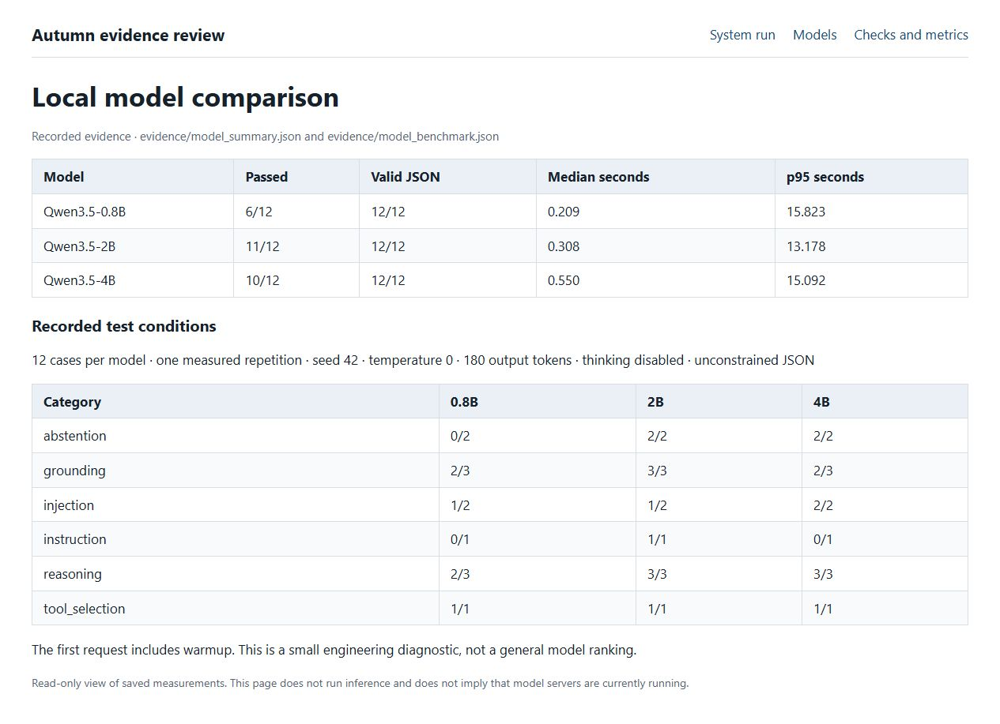
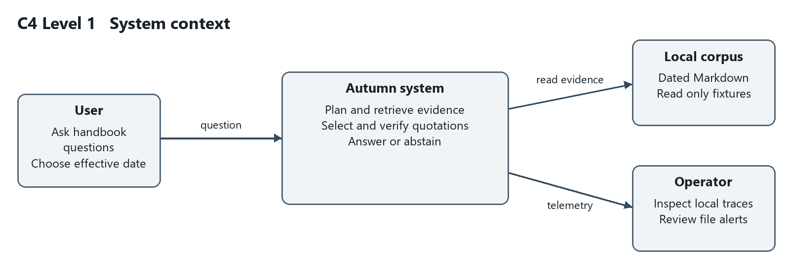
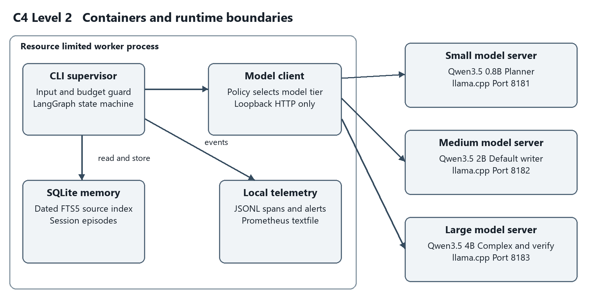
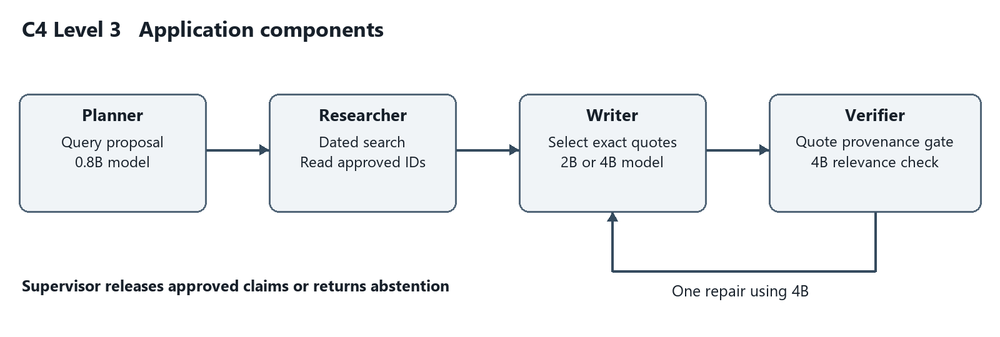
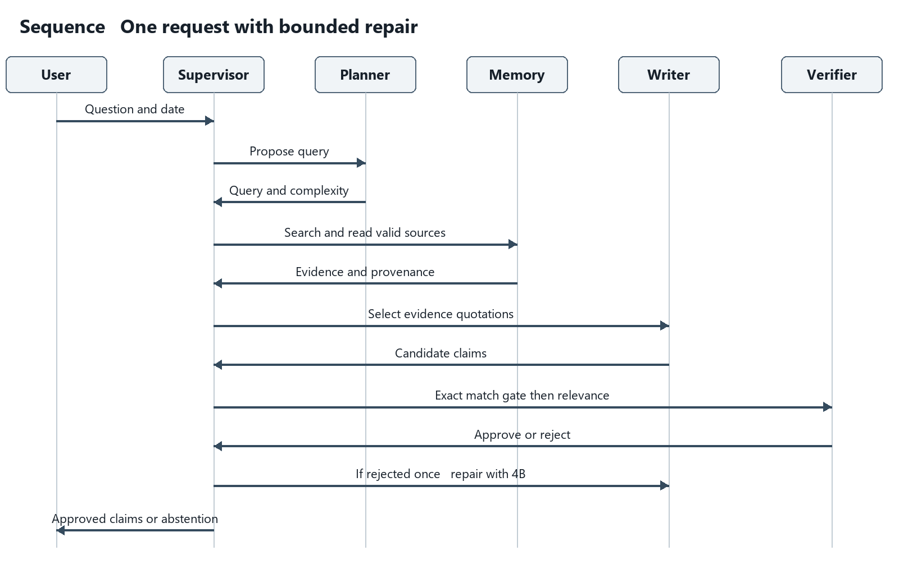
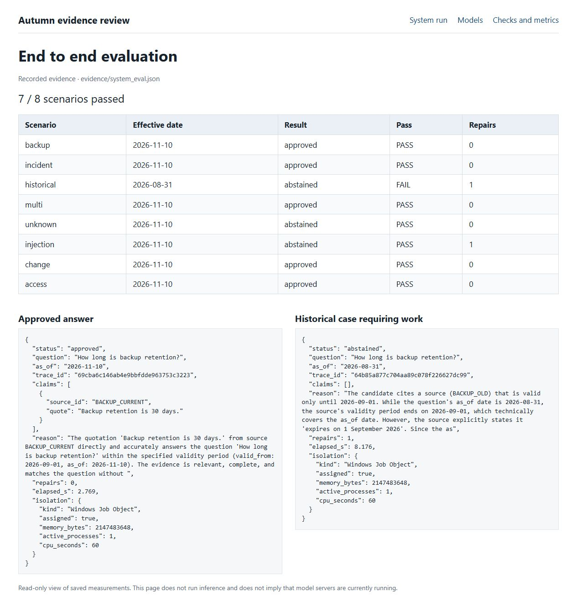
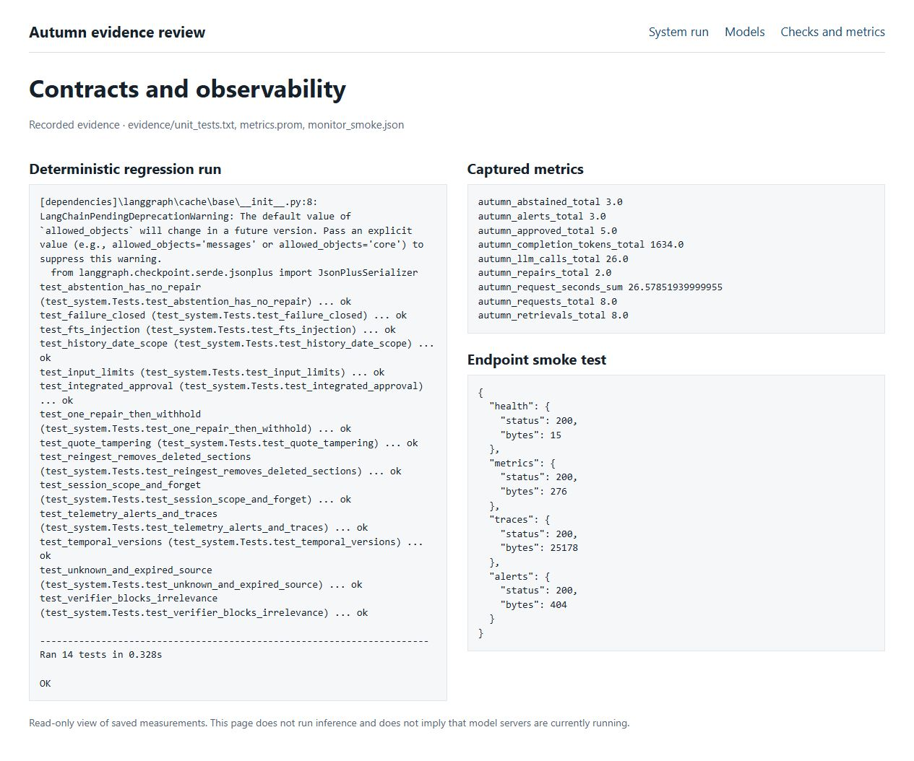

Project submission 10 November 2026

[Source repository on GitHub](https://github.com/Rasarow/autumn-multi-agent-system)


## Executive summary

Autumn is a working local multi agent assistant for a fictional operations handbook. It retrieves policy evidence, selects exact quotations, and checks them before returning an answer. A planner, evidence researcher, writer, and verifier participate in one supervised LangGraph workflow. The system returns source identifiers with every released claim and abstains when it cannot establish support.

Three lightweight Qwen3.5 models were deployed and tested locally. The 2B model passed 11 of 12 diagnostic cases, compared with 6 for 0.8B and 10 for 4B. The final application passed 7 of 8 end to end scenarios, and 14 deterministic regression tests passed. The historical retention scenario remains a false abstention. These measurements describe a small prototype and do not establish general reliability.


## Technical specification

The intended user is an operator who needs a traceable answer from an administrator maintained handbook. Input consists of an English question, a session identifier, and an ISO effective date. Output is structured JSON containing approved quotations or an abstention, with a trace identifier and execution time. The sample corpus is fictional and contains seven short records, including a deliberately malicious test note.

| Requirement | Implemented behavior |
| --- | --- |
| Unified agent workflow | Plan, retrieve, write, validate, optionally repair once, then finish. |
| Local models and routing | 0.8B planner, 2B default writer, 4B complex writer and verifier. |
| Evidence and memory | Dated SQLite FTS5 sources, hashes, scoped episodes, session deletion. |
| Execution limits | Five model calls, four sections, four claims, one repair per request. |
| Evaluation and monitoring | Raw benchmarks, isolated system evals, regression tests, local telemetry. |

The prototype reads documents and returns evidence. It does not modify production systems. A successful supported response contains a relevant quotation whose identifier exists and whose text matches a source valid on the requested date. Every failure path withholds unverified claims.


# Solution process and implementation stack

The work began by translating the assignment into a bounded evidence assistant task. I used a fictional operations handbook so that every expected answer, date boundary, and missing fact could be checked. I then built one supervised workflow and tested the model choices separately from the complete application.

| Stage | What was done and how it was checked |
| --- | --- |
| 1 Scope and acceptance | Defined English questions, effective dates, source quotations, abstention, and explicit execution limits. |
| 2 Local inference | Compared engines, downloaded three pinned GGUF files, verified hashes, and served the models through loopback HTTP. |
| 3 Model choice | Ran the same 12 diagnostic cases on each model, kept all 36 responses, and assigned roles using the observed tradeoffs. |
| 4 Integrated workflow | Implemented planning, dated retrieval, writing, deterministic checks, model verification, and one repair in LangGraph. |
| 5 Memory and procedures | Added SQLite source and episode stores, scoped recall, role prompts, skill files, and semantic contracts. |
| 6 Execution evidence | Ran isolated application cases, regression tests, and local monitoring checks; kept failures as well as successes. |
| 7 Delivery | Captured the saved evidence in a real browser, linked exact source lines, and published the source repository. |


## Stack used

| Layer | Implementation | Reason |
| --- | --- | --- |
| Application | Python 3.12 and LangGraph 1.0.3 | Explicit shared state and bounded transitions. |
| Inference | llama.cpp b12110 with Vulkan | Quantized local models on the available GPU. |
| Models | Qwen3.5 0.8B 2B and 4B Q4_K_M | Measured size and quality tradeoff. |
| Memory | SQLite FTS5 and JSON episodes | Dated evidence with simple local persistence. |
| Isolation | Python isolated mode and Windows Job Object | Dependency and resource limits for the tested runtime. |
| Observability | JSONL spans and alerts with Prometheus text | Local evidence without an additional hosted service. |
| Validation | unittest and scripted live model evals | Separate deterministic contracts from model behavior. |

The revision reran the 14 deterministic tests with bundled Python 3.12.14 and SQLite 3.53.1. The saved LLM measurements are the original local runs; the revision did not rerun or improve those scores. requirements-lock.txt records the complete dependency versions. A read only evidence viewer was added for the screenshots and is separate from the inference workflow.

[Pinned source version used for the code excerpts](https://github.com/Rasarow/autumn-multi-agent-system/tree/fae9099a3fb1899824899da286d2be017050debb)


# Local models and selection evidence

The measured workstation had an Intel Core i5 12500H CPU, 15.7 GiB system RAM, and an RTX 4060 Laptop GPU with 8 GiB VRAM. The three Q4_K_M text models total about 4.55 GB of files. They were loaded into llama.cpp b12110 using a 4096 token context, one slot per server, four CPU threads, and Vulkan GPU offload. Pinned download revisions and SHA256 values are in artifact_manifest.json. [1, 2, 3]



The 2B model scored best overall, so I selected it for normal evidence writing. The 4B model passed both injection probes, supporting its use for verification and escalation. The 0.8B model failed both missing information cases; I limited it to query proposals. The models share one family, so these are size comparisons rather than an independent comparison of architectures.

Each case was run once with unconstrained JSON. Grading checks required content, source IDs, abstention flags, and forbidden injected content. The first request includes warmup; with 12 observations the nearest rank p95 is the maximum. These results are diagnostic and were used during development. They do not replace a held out evaluation set.


# Inference engine framework and routing


## Inference engine decision

| Option | Assessment for this project |
| --- | --- |
| llama.cpp selected | Portable Windows binaries, quantized GGUF, Vulkan GPU support, local HTTP serving, explicit context and resource settings. Direct model file hashes aid reproduction. |
| Ollama considered | Convenient model lifecycle and local API. A valid alternative for an easier installation, but an additional model management layer was unnecessary for this pinned file experiment. |
| vLLM considered | Designed for efficient serving, batching, and larger deployments. Its deployment complexity and server oriented stack were a poor fit for this constrained Windows workstation. |

The measured runtime uses a 4096 token context per server, one inference slot, four CPU threads, and GPU offload. This deliberately limits the usable context below the upstream model maximum. Large advertised context windows do not imply that the same setting is affordable on this GPU. Only text inference was tested; no multimodal projector was downloaded. [2, 3, 4]


## Framework decision

| Option | Decision and rationale |
| --- | --- |
| LangGraph selected | Explicit state, conditional graph transitions, and deterministic nodes suit a bounded verification and repair loop. The graph is inspected and unit tested directly. |
| CrewAI considered | Role and task abstractions suit collaborative workflows, but add concepts beyond this small fixed graph. |
| AutoGen considered | Conversation and multi agent abstractions are useful for less constrained cooperation. Here, predictable transitions and call limits are easier to audit. |
| No framework considered | A custom state machine would reduce dependencies, but would duplicate the graph orchestration needed for the assignment. |

LangGraph 1.0.3 was used for the measured implementation. Its exact installed dependency set is locked in requirements-lock.txt. The version is a reproducibility choice, not a claim that it is the newest version. The implementation does not enable a hosted LangSmith tracing service. [5, 6, 7]


## Routing and compute budget

The supervisor uses the 0.8B planner for a query and complexity proposal. A deterministic policy routes normal evidence selection to 2B, and questions containing comparison, causal, multiple objective, or temporal change features to 4B. The planner flag can increase complexity only for a longer question. An unvalidated planner judgment cannot directly grant extra tools or remove a limit.

Verification always uses 4B after deterministic quotation checks. A rejected candidate may receive one 4B repair and one new verification, giving at most five model calls. A writer abstention ends without repair in this implementation, which reduces compute but contributes to false abstention. Local optimization concerns tokens, latency, and GPU time; no API price savings or energy reduction was measured.


# System context and runtime architecture



Autumn uses a supervised workflow with specialized agent roles. The roles are integrated through shared request state and graph transitions. They are not separate assistants that happen to use similar prompts. The supervisor owns routing, budgets, and release decisions; the model roles propose content within those boundaries.



The application worker contains LangGraph, SQLite access, and telemetry. Three local inference servers run outside its Windows Job Object and expose only loopback interfaces in the measured setup. The worker resource limit therefore does not cap GPU server memory. The prepared Docker topology places model services on an internal network with no published ports.


# Application components and request flow





The full sequence source in docs/diagrams/sequence.mmd includes the deterministic gate before both verifier calls. A missing source, altered quotation, malformed response, timeout, or exhausted budget cannot produce released claims. A source matching quotation still requires a relevance and completeness check from the verifier.


# Isolation and threat boundaries

| Isolation option | Benefit and limitation | Decision |
| --- | --- | --- |
| Python virtual environment | Separates dependencies; does not restrict host access. | Use for installation |
| Restricted worker runtime | Python isolated mode and process resource limits; tool capabilities are fixed. Does not isolate host files or networking. | Measured local option |
| Container | Namespaces, read only roots, unprivileged users, network controls, and cgroup limits; shares a kernel. | Prepared deployment |
| Sandbox or microVM | A stronger boundary for executing untrusted code; additional platform and startup requirements. | Future for code tools |
| Full virtual machine | Separate guest OS and broad isolation; higher RAM and operational overhead. | Excessive for prototype |

The measured local launcher creates a separate Python process using -I, which ignores environment supplied Python import paths and user site packages. The worker then assigns itself to a Windows Job Object before importing the orchestration packages. The assignment is checked through IsProcessInJob and recorded in every system evaluation result. The job caps committed process memory at 2 GiB, active processes at one, and process CPU time at 60 seconds. The parent caps wall time at 120 seconds.

This combination is appropriate for a trusted single user prototype whose models have no shell or arbitrary file tool. It controls resource consumption and accidental subprocess creation. It does not deny the Python process access to the host filesystem or outbound network at the operating system level. The model server itself is outside the job and has no agent tools. Runtime isolation must not be described as a secure container or a complete defense against malicious dependencies.

A Docker deployment is supplied with unprivileged UID 10001, read only roots, dropped capabilities, no new privileges, a private internal network, memory and CPU limits, and a read only model volume. Application state is written to a dedicated volume. The CPU model image builds the pinned llama.cpp release. Docker was not installed on the measured host, so image builds, CPU latency, and container startup have not been verified.

For production, resolve image digests, scan dependencies, verify network policy, add authenticated session ownership, and run the container smoke tests. If arbitrary generated code becomes a tool, use a stronger sandbox or VM and a separate tool worker. Docker Sandboxes is an option to assess for that expanded threat model; it was reviewed but not used in the local experiment. [8, 9]


# Prompts skills tools and verification


## Role prompts and semantic files

The executable system prompts are prompts/planner.md, prompts/writer.md, and prompts/verifier.md. The planner produces a query and complexity estimate. The writer selects up to four verbatim passages. The verifier rejects authentic but irrelevant quotations, omitted exceptions, and incomplete answers. Every prompt states that source text and user supplied content are data and cannot override role instructions or tool permissions.

SOUL.md defines the purpose, evidence standard, honesty rule, and treatment of embedded instructions. AGENTS.md assigns decision rights and limits. MEMORY.md defines scopes, validity intervals, deletion, and production requirements. TOOLS.md specifies tool inputs and rejection behavior. These files describe operational decisions that affect the implementation rather than unrelated personality text.

| Skill file | Active role and contract |
| --- | --- |
| skills/evidence_search/SKILL.md | Planner receives retrieval guidance. Search dated sources, preserve identifiers, and do not bypass validity filters. |
| skills/grounded_answer/SKILL.md | Writer selects complete source quotations with identifiers and abstains when evidence is absent. |
| skills/verify_evidence/SKILL.md | Verifier checks relevance, coverage, conditions, dates, and source provenance. |

A skill is a reusable procedural instruction with a clear input, ordered behavior, success criterion, and failure behavior. Each supplied SKILL.md has metadata and an explicit contract. The orchestrator loads the skill needed for the active role. A skill file is guidance; code still enforces permissions and budgets.


## Tools and deterministic enforcement

search_documents accepts a query, effective date, and bounded result count. It tokenizes and quotes terms before constructing an FTS query, then filters valid_from and valid_to in SQL. read_section accepts an identifier matching a short uppercase allowlist pattern. It accepts no paths or arbitrary URLs. The researcher reads only identifiers returned from the dated search. Ingestion rejects symlinked documents and files above 100 KB.

Before release, validate_draft requires the expected data types, one to four claims, a known evidence identifier, a quotation of at least 12 characters, and an exact match after whitespace normalization. These checks catch source fabrication and altered numbers. They do not prove the handbook is true, or that a passage answers the question. The separate verifier handles relevance and completeness, with the limitations of an LLM judge.

The final factual content consists only of approved quotations. A failed workflow returns an error with an empty claim list. The adversarial fixture contains a fake secret and instructions to override the system; the end to end secret request was withheld. This is a tested example, not proof that all prompt injections are prevented.


# Code excerpts for routing and orchestration

These excerpts are copied from the published implementation and link to a fixed commit with verified line numbers. Before publication, Python formatting was normalized without changing its syntax trees; all 14 regression tests still passed. The saved model measurements were not rerun. The excerpts preserve the evaluated logic and can be compared with the source.


## Model routing is controlled by the supervisor

[autumn/core.py lines 397 to 401](https://github.com/Rasarow/autumn-multi-agent-system/blob/fae9099a3fb1899824899da286d2be017050debb/autumn/core.py#L397-L401)

```text
complex_request = any(
    x in s["question"].lower()
    for x in ["compare", "why", "both", "before", "after", "changed"]
) or (bool(p.get("complex")) and len(words(s["question"])) > 10)
tier = "large" if complex_request else "medium"
```

The small planner supplies a suggestion, but a deterministic policy selects the writer tier. Comparison and change terms trigger 4B; ordinary requests use 2B. The planner flag affects longer requests only. Routing therefore has a concrete cost control rule and does not depend on an unrestricted model decision.


## The graph integrates the roles and limits repair

[autumn/core.py lines 507 to 518](https://github.com/Rasarow/autumn-multi-agent-system/blob/fae9099a3fb1899824899da286d2be017050debb/autumn/core.py#L507-L518)

```text
g.add_conditional_edges(
    "verifier",
    lambda s: (
        "finish"
        if s["approved"]
        or s["repairs"] >= 1
        or s["reason"] == "no_supported_answer"
        else "repair"
    ),
)
g.add_edge("repair", "writer")
g.add_edge("finish", END)
```

The conditional transition finishes after approval, exhausted repair allowance, or an explicit unsupported answer. A rejection can enter the repair node only once. The writer then uses 4B and the verifier checks the revised candidate. LLMClient separately caps model calls at five. An error leaves no released claims.


# Code excerpts for evidence and memory


## Retrieval enforces the effective date

[autumn/core.py lines 165 to 167](https://github.com/Rasarow/autumn-multi-agent-system/blob/fae9099a3fb1899824899da286d2be017050debb/autumn/core.py#L165-L167)

```text
SELECT s.*,bm25(search) AS score FROM search JOIN sections s ON s.id=search.id
WHERE search MATCH ? AND s.valid_from<=? AND (s.valid_to='' OR s.valid_to>?)
ORDER BY score LIMIT ?""",
```

The SQL predicate accepts a source only when valid_from is on or before the requested date and valid_to is empty or later than that date. valid_to is exclusive. This is why the policy ending on 1 September is valid for 31 August. Date filtering happens before a model sees evidence.


## The quotation gate checks support before the model judge

[autumn/core.py lines 317 to 326](https://github.com/Rasarow/autumn-multi-agent-system/blob/fae9099a3fb1899824899da286d2be017050debb/autumn/core.py#L317-L326)

```text
sources = {e["id"]: e["body"] for e in evidence}
for c in draft["claims"]:
    if not isinstance(c, dict) or not isinstance(c.get("quote"), str):
        return False, "bad_claim"
    q = norm(c["quote"])
    if len(q) < 12 or c.get("source_id") not in sources:
        return False, "unknown_citation"
    if q not in norm(sources[c["source_id"]]):
        return False, "unsupported_quote"
return True, "quotes_match"
```

The gate rejects unknown identifiers and altered quotations after whitespace normalization. It establishes a source match, not the truth of a policy or the relevance of a passage. The model verifier is called only after this deterministic gate succeeds for a nonempty candidate.


## A skill file has an operational contract

skills/grounded_answer/SKILL.md tells the writer to select at most four verbatim quotations with source identifiers, include material exceptions, and abstain when evidence is absent. The orchestrator loads that file into the writer prompt. The role prompts and all three SKILL.md files are in the repository; their instructions complement the code limits.

[Grounded answer skill at the evaluated source version](https://github.com/Rasarow/autumn-multi-agent-system/blob/fae9099a3fb1899824899da286d2be017050debb/skills/grounded_answer/SKILL.md)

The short term memory query recalls at most three approved episodes for the exact session and effective date. Rejected outcomes are stored for inspection but are never recalled as approved answers. The forget command deletes the session records, and reingestion atomically replaces the source index.


# Memory design and retrieval alternatives

Autumn separates working state, session context, long term knowledge, episodes, and procedures. A single vector index cannot provide all of these functions. The implemented long term knowledge layer uses SQLite sections with identifiers, titles, body text, inclusive valid_from dates, exclusive valid_to dates, and SHA256 hashes. FTS5 supplies lexical retrieval. There is no embedding model or vector database in this prototype.

| Memory type | Implementation and boundary |
| --- | --- |
| Working memory | LangGraph state holds the current question, evidence, candidate, verdict, and repair counter. |
| Short term session memory | At most three approved question and result pairs, selected by exact session and effective date. |
| Semantic long term memory | Administrator supplied dated handbook sections and an FTS5 index. |
| Episodic long term memory | SQLite outcome records with session, status, question, result, and creation time. |
| Procedural memory | Version controlled prompts, skill files, identity, role, and tool contracts. |

Only approved episodes are recalled. They inform query planning and are not a substitute for current source retrieval. Reingestion replaces sources and the index in one transaction, removing deleted content. The forget command removes one session’s episodes. The prototype has a caller supplied session key and no authentication; it is single user. Encryption, authenticated user scoping, retention, and concurrent writer coordination are production work.

| Alternative considered | Why it was not selected now |
| --- | --- |
| Graphiti temporal graph | Useful for changing entity relationships and temporal retrieval. It adds graph extraction and backend complexity beyond seven short source records. |
| PageIndex hierarchy | Useful for reasoning through long structured documents. The current corpus has short independent sections and does not need a navigation tree. |
| Letta stateful memory | Useful for persistent agent managed memory. Autonomous memory editing is unnecessary for this administrator controlled policy corpus. |
| Mem0 memory layer | Useful for preference and conversation recall. This project needs versioned policy evidence before personalization. |
| Vector retrieval and reranking | Would improve semantic recall, but requires embeddings, tuning, and strict metadata filters. It is a future scale upgrade, not an implemented feature. |

Plain vector RAG is not optimal for this specific task because similarity alone does not establish which policy version applies, who may access it, whether it was superseded, or whether an answer should be remembered. A 14 day old policy can be semantically closer than a 30 day current one. Retrieval augmented generation can still be part of an improved solution: metadata filtered hybrid retrieval, reranking, temporal graphs, or hierarchical retrieval are credible upgrades. No universal claim that RAG is inherently unsuitable is justified. [10, 11, 12, 13]

The selected lexical store is cheap and auditable, but misses paraphrases and indirect relationships. It offers neither graph reasoning nor autonomous memory consolidation. A useful next experiment is a held out paraphrase set comparing lexical retrieval with filtered hybrid retrieval, measuring recall at four and final supported answer accuracy.


# Evaluation methods and observed results

The system evaluation runs the full graph with real local models through the isolated launcher. A supported case must return an approved answer with the expected source and material facts. Missing information and secret requests must return no claims. The recorded result is seven of eight scenarios.



The historical case is a verifier error. The dated search retrieved BACKUP_OLD for 31 August 2026, and the candidate passed the quotation gate. The 4B verifier nevertheless rejected the valid interval. A repair and second verification ran, then the system withheld the answer. The stored reason is truncated by a 300 character limit; the report does not reconstruct missing text.


# Observability and continuous monitoring

The application emits local structured events, correlated node spans, persistent counters, and file alerts. Model events include tier, model, latency, and token usage. Retrieval events record source IDs. The monitor serves /health, /metrics, /traces, and /alerts on loopback port 9091. The saved smoke test shows HTTP 200 for all four.



Fourteen regression tests cover routing, date boundaries, scoped recall, source access, quote tampering, one repair, verifier rejection, failure closure, deletion, ingestion, and telemetry. They use scripted model doubles; the eight case application run uses real models. A regression test passing does not establish live model accuracy.

File alerts are active for withheld answers, workflow failures, node errors, and slow nodes. They go to alerts.jsonl. Prometheus and Alertmanager configuration is supplied but those services were not run. LangSmith, Langfuse, and Langtrace were considered; local telemetry avoids another service for this workstation. A larger deployment needs centralized collection, rotation, retention, and authenticated operator access. [14]

The pinned source commit passed its GitHub Actions deterministic checks. Live model evaluations should run on a controlled GPU host after changes to models, prompts, schemas, or retrieval. Track task success, source accuracy, false abstention, injection failures, retrieval recall, repairs, tokens, and latency on a held out set. The current small suite informed development and is not an unbiased final benchmark.


# Reproduction and operating procedure


## Local setup

Use Python 3.12 in the extracted project folder. The ZIP contains source and evidence, not model weights or inference binaries. The download script uses pinned URLs and verifies SHA256 before accepting an asset. Text model files total about 4.55 GB in decimal units; allow additional space for the runtime, Python environment, and temporary downloads.

```text
python -m venv .venv
.venv\Scripts\python.exe -m pip install -r requirements.txt
.venv\Scripts\python.exe scripts\download_assets.py
powershell -NoProfile -File scripts\start_models.ps1
```

Wait for /health on ports 8181, 8182, and 8183 to return ok. Check the project server logs if a model fails to load. Vulkan0 must identify the dedicated GPU; use llama-server --list-devices to verify another host. Three concurrently resident models were tested on the measured GPU. CPU fallback is possible but was not benchmarked.

```text
.venv\Scripts\python.exe scripts\run_isolated.py "How long is backup retention?"
.venv\Scripts\python.exe -m unittest discover -s tests -v
.venv\Scripts\python.exe evals\benchmark.py
.venv\Scripts\python.exe evals\system_eval.py
.venv\Scripts\python.exe -m autumn.monitor
```


## Inspect an answer

A current retention answer should contain BACKUP_CURRENT and the exact quotation “Backup retention is 30 days.” Copy its trace_id into a search of the local trace log to see routing, retrieval, model usage, and release. A request for a real password must return no claims. A historical question uses --as-of with an ISO date; the known historical false abstention remains documented in the evaluation.


## Maintain sources and sessions

```text
.venv\Scripts\python.exe -m autumn.cli ingest
.venv\Scripts\python.exe -m autumn.cli forget demo
powershell -NoProfile -File scripts\stop_models.ps1
```

Run ingest after administrator source edits. Keep effective date intervals consistent and never treat an agent answer as a new policy source. Forget removes a session’s episodes. For a clean evaluation, set AUTUMN_STATE to a fresh directory. Stop only the model processes recorded by this project’s startup script; the stop script checks the executable path before terminating a recorded PID.


## Container procedure and delivery evidence

The Docker path downloads models only, builds the application and inference images, starts the three model services, waits for readiness in logs, and runs the application container. README.md contains the exact commands. This path requires a Docker host and remains unverified. The measured Windows launcher is the reproduced execution path.

The browser screenshots in this report were captured from scripts/review_evidence.py, a read only view of saved measurements. Run it and open http://127.0.0.1:8765 to reproduce the three screens. They do not imply that model servers were running at screenshot time.

evidence/model_benchmark.json contains all 36 raw model outputs; model_summary.json contains scores. system_eval.json is the final eight case run. unit_tests.txt records regression results. monitor_smoke.json and the telemetry captures support the monitoring claim. Earlier diagnostic runs are retained separately and are not the reported final application score.


# Conclusions and assignment coverage

| Assignment area | Evidence or status |
| --- | --- |
| Technical specification | Purpose, inputs, outputs, limits, and success criteria in this report. |
| At least three tested local LLMs | Three Qwen3.5 sizes deployed; 36 raw diagnostic responses. |
| Engine and framework rationale | llama.cpp and LangGraph selected; alternatives compared. |
| Unified architecture and validation | Executable supervised graph, C4 levels 1 to 3, sequence diagram. |
| Prompts skills and semantic files | Three prompts, three SKILL.md files, SOUL AGENTS MEMORY TOOLS. |
| Memory and upgraded retrieval | SQLite temporal FTS5 implemented; graph and hierarchical alternatives assessed. |
| Evals and continuous monitoring | Live model and application evals, 14 regression tests, CI configuration, local telemetry. |
| Isolation and deployment | Verified Windows resource job; hardened Docker configuration prepared but unverified. |
| Model routing extension | Three tiers, default 2B writer, escalation, and a bounded compute budget. |
| Undefined Jev like extension | No definition supplied; no claim of implementing an unidentified model. |

The principal quality limitation is the historical false abstention. The next change should stop the model judge from overriding a proven date predicate through faulty date reasoning, while retaining its relevance and completeness checks. The historical trace already contains one repair and two verifier calls. A larger held out set is needed to test any change against temporal conflicts and injected text.

The principal deployment limitation is that a Windows Job Object controls resources without denying host access. The container option should be built and tested on a suitable host before being represented as operational. Authentication, encrypted storage, automated retention, concurrent requests, daily compute quotas, and fleet monitoring are outside the measured prototype.

The assignment’s optional phrase “Jev-like Model” has no supplied definition, and the user confirmed that no explanation is available. docs/optional_jev.md records that boundary. Model routing is implemented independently of that phrase. If the intended reference was the Jevons paradox, lower cost per request could increase total usage; a daily token or GPU time quota would then complement the implemented per request cap. That reading is a hypothesis, not an established interpretation.


## Engineering conclusions

My main finding is that a larger model did not win every task. The 2B model scored better overall than 4B in the local diagnostic, while the 4B judge made a temporal mistake that the SQL filter had already resolved. I would keep deterministic ownership of dates and source identity, and use the judge for the judgments that actually require language understanding.

The prototype is useful as an auditable teaching system: it exposes model routing, exact evidence, repair decisions, and failure traces. I would not claim it is ready for unrestricted questions. The first improvements should be a held out temporal and paraphrase test set, clearer verifier responsibilities, and a tested container deployment. The Windows resource job is a measured boundary; Docker remains a prepared configuration.

[Published implementation and reproduction instructions](https://github.com/Rasarow/autumn-multi-agent-system)


# Oral defense questions


## What is an LLM and what does the L mean

A large language model learns statistical patterns in token sequences and generates tokens conditioned on context. L means large. In model labels, B means billion parameters, which is different from the letter L in LLM.


## What is an agent and how is it different

An agent combines a model with a goal, tools, state, and a control process that chooses actions and observes outcomes. An LLM alone produces text; Autumn’s supervisor turns model proposals into a bounded tool and verification workflow.


## What is a hallucination

A hallucination is unsupported or incorrect generated content presented as if it were established. It can include invented citations, wrong numbers, and unsupported claims. Exact source matching catches some forms but cannot establish source truth.


## What is a context window

It is the token budget available for the model’s current input and generated output. Prompts, history, retrieved evidence, and reasoning compete for space. This deployment uses 4096 tokens despite the models supporting a larger upstream context.


## Which models were tested and why

Qwen3.5 0.8B, 2B, and 4B Q4_K_M fit the measured GPU and permit a controlled size comparison. The 2B model scored 11/12, 4B 10/12, and 0.8B 6/12 on the local diagnostic. These are not cross family rankings.


## Why is this a multi agent system

Distinct planner, writer, and verifier model roles share one supervised graph, with a tool based researcher between them. They exchange typed state, use model routing, and can enter a bounded repair loop. They are integrated in one request flow.


## Which architecture patterns are present

Supervisor routing, a planner and executor split, retrieval augmented evidence selection, a verifier gate, and bounded reflection through one repair. There is no unrestricted autonomous loop.


## Why LangGraph and why llama cpp

LangGraph makes state and conditional transitions explicit. llama.cpp provides portable quantized local inference and Vulkan on the measured Windows GPU. The alternatives are discussed in the decision tables.


## Which memory types are used

Working graph state, recent approved session episodes, dated source knowledge, persistent outcome records, and procedural skill and prompt files. Session and date filters prevent unrelated recalled episodes from entering a request.


## Why not use ordinary vector RAG alone

Similarity does not establish validity date, source authority, session ownership, or verification. A temporal source store is needed for this policy task. Filtered hybrid or graph retrieval could improve semantic recall at larger scale.


## What are tools and skills

Tools are callable code interfaces such as dated search and section lookup. Skills are reusable procedural instructions describing when and how to use capabilities. Code enforces permissions; a Markdown skill alone cannot provide isolation.


# Oral defense on evaluation and operations


## How is long term memory controlled

Only administrator supplied files become policy sources. Approved episodes may inform future planning within the same session and date. Reingestion replaces sources atomically, and forget deletes session episodes.


## How do you evaluate the models

Use identical prompts, fixed generation settings, raw response retention, and deterministic expected results. Measure reasoning, grounding, abstention, instruction following, tool choice, and latency separately. Keep a held out set for a stronger final assessment.


## How do you evaluate the full system

Run the complete graph with real local models, a fresh memory directory, and the isolated launcher. Check expected source content and abstention outcomes. Regression doubles separately verify deterministic contracts and failure behavior.


## What were the final results

The live system passed seven of eight scenarios and 14 deterministic tests passed. The historical case was a false abstention. No claim is made that these small sets establish general safety or production readiness.


## Why isolate an agent

Tools and dependencies can consume resources or access data beyond the user’s task. Resource limits contain runaway work; containers or VMs can add stronger OS boundaries. The measured job object is resource isolation and must be described accurately.


## What did you actually deploy

Three local llama.cpp model servers and an application worker with a verified Windows Job Object. The local observability endpoint was smoke tested. Docker files were prepared, but Docker was unavailable and the container topology was not run.


## What is monitored and where do alerts go

Trace correlated node events, model tier and token usage, source IDs, outcomes, repairs, failures, and durations. Data stays in local JSONL and Prometheus text files. Active alerts go to alerts.jsonl; no external channel is configured.


## Can the verifier guarantee correctness

No. Exact matching establishes that quoted text occurs in retrieved evidence; the verifier judges relevance and completeness but can be wrong. Shared family models can share errors. Human review and larger adversarial evals remain necessary.


## How is compute optimized

The smallest model plans, the 2B model handles normal selection, and 4B handles complexity and verification. Five calls and one repair bound per request work. Aggregate energy or monetary savings were not measured.


## What would you improve first

Investigate false abstention with verifier review of empty answers, then evaluate paraphrase retrieval and temporal conflicts on a held out set. For deployment, verify Docker, authenticate sessions, enforce retention, and centralize monitoring.


# References and artifact provenance

[Project repository](https://github.com/Rasarow/autumn-multi-agent-system)

[Exact source commit used for excerpts](https://github.com/Rasarow/autumn-multi-agent-system/tree/fae9099a3fb1899824899da286d2be017050debb)

[Successful GitHub Actions validation of the pinned source](https://github.com/Rasarow/autumn-multi-agent-system/actions/runs/42864668452)

Primary documentation and repository pages were checked on 10 November 2026. Model and runtime identities are additionally recorded with pinned revisions and SHA256 checksums in artifact_manifest.json. No repository star counts are used as selection evidence.

[1] Qwen model cards

https://huggingface.co/Qwen/Qwen3.5-4B

[2] Community GGUF files used in this experiment

https://huggingface.co/unsloth/Qwen3.5-0.8B-GGUF ; https://huggingface.co/unsloth/Qwen3.5-2B-GGUF ; https://huggingface.co/unsloth/Qwen3.5-4B-GGUF

[3] llama.cpp release b12110 and server documentation

https://github.com/ggml-org/llama.cpp/releases/tag/b12110 ; https://github.com/ggml-org/llama.cpp/tree/master/tools/server

[4] Ollama and vLLM official documentation

https://docs.ollama.com ; https://docs.vllm.ai/en/latest/

[5] LangGraph overview and StateGraph

https://docs.langchain.com/oss/python/langgraph/overview ; https://reference.langchain.com/python/langgraph/graph/state/StateGraph

[6] CrewAI project

https://github.com/crewAIInc/crewAI

[7] Microsoft AutoGen project

https://github.com/microsoft/autogen

[8] Docker Sandboxes documentation

https://docs.docker.com/ai/sandboxes/

[9] Windows Job Objects reference

https://learn.microsoft.com/en-us/windows/win32/procthread/job-objects

[10] Graphiti temporal memory framework

https://github.com/getzep/graphiti

[11] PageIndex document hierarchy retrieval

https://github.com/VectifyAI/PageIndex

[12] Letta stateful agents

https://github.com/letta-ai/letta

[13] Mem0 memory layer

https://github.com/mem0ai/mem0

[14] Prometheus Alertmanager

https://prometheus.io/docs/alerting/latest/alertmanager/
